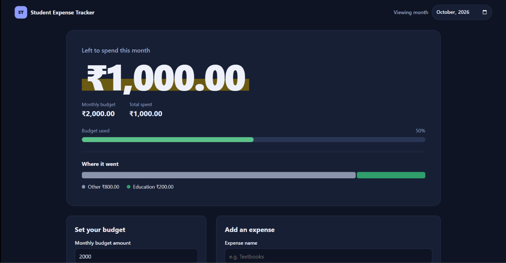
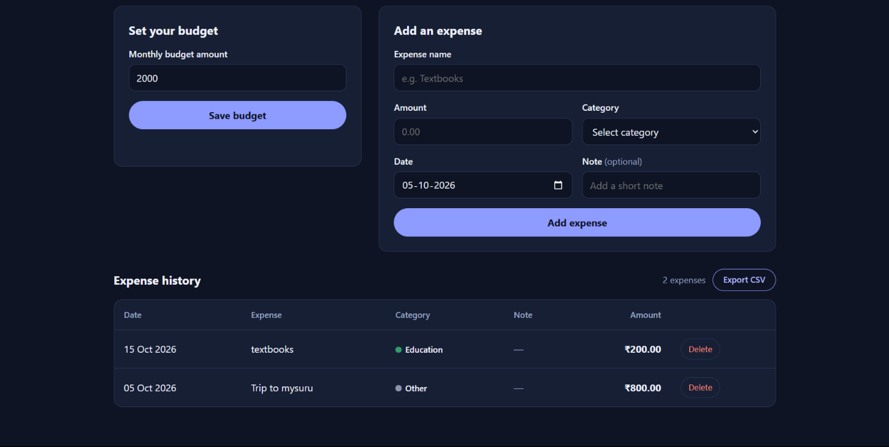

# Student Expense Tracker

A simple, responsive web app for tracking a monthly student budget and expenses. Built with plain HTML, CSS and JavaScript, with no frameworks or build step.

**Live demo:** https://hcommit.github.io/student-expense-tracker/




## Features

- Set a monthly budget and see how much is left to spend
- Add expenses with a name, amount, category, date and optional note
- Colored spending breakdown by category
- Progress bar that turns amber at 80% and red when over budget
- Browse any month with the month picker
- Delete expenses with a confirmation prompt
- Export the current month's expenses as a CSV file
- Data saved in your browser (localStorage), so it stays after you close the page
- Dark mode, mobile-friendly layout and keyboard-accessible forms

## How to run

1. Download or clone this repository:
   ```bash
   git clone https://github.com/Hcommit/student-expense-tracker.git
   ```
2. Open `index.html` in your browser. No installation is needed.

## Project structure

```
student-expense-tracker/
├── index.html   # page structure
├── style.css    # styling, dark mode, responsive layout
├── script.js    # app logic, storage, validation, CSV export
└── README.md
```

## Notes

- Amounts are shown in Indian rupees (INR).
- Data is stored only in your own browser and is never sent anywhere.
- The month picker is not supported in some browsers (such as Firefox on desktop). There, type the month as `YYYY-MM`.

## Built with

HTML5, CSS3 and vanilla JavaScript.

## Author

Hardik Gupta ([@Hcommit](https://github.com/Hcommit))
